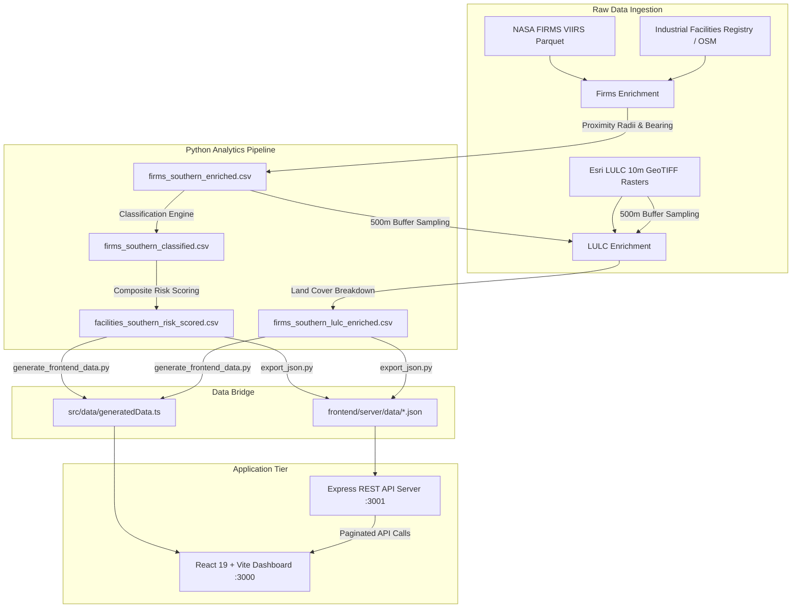

# 🛰️ Geospatial Fire & Industrial Anomaly Risk Engine

An end-to-end geospatial intelligence pipeline and interactive tactical dashboard for detecting, classifying, and risk-assessing thermal anomalies (wildfires, industrial flares, and refinery exceedances) across the Indian subcontinent.

The platform ingests NASA FIRMS VIIRS satellite thermal detections, matches them against OpenStreetMap (OSM) and industrial facility registries, samples 10-meter Esri Land Use/Land Cover (LULC) rasters, computes a multi-factor risk score, and surfaces actionable intelligence on a high-performance Leaflet tactical map and Human-in-the-Loop (HITL) analyst review queue.

---

## 📋 Table of Contents
- [System Architecture](#-system-architecture)
- [Project Directory Structure](#-project-directory-structure)
- [Prerequisites](#-prerequisites)
- [⚡ Quick Start (Run Dashboard Immediately)](#-quick-start-run-dashboard-immediately)
- [🔄 Full Data Pipeline (Ingesting Raw Satellite Data)](#-full-data-pipeline-ingesting-raw-satellite-data)
  - [1. Data Prerequisites & File Placement](#1-data-prerequisites--file-placement)
  - [2. Python Environment Setup](#2-python-environment-setup)
  - [3. Pipeline Execution Steps](#3-pipeline-execution-steps)
- [🌐 REST API Reference](#-rest-api-reference)
- [🖥️ Frontend Tactical Features](#️-frontend-tactical-features)
- [⚙️ Configuration & Ports](#️-configuration--ports)
- [🛠️ Troubleshooting](#️-troubleshooting)

---

## 🏗️ System Architecture



---

## 📂 Project Directory Structure

```text
.
├── README.md                                  # Main documentation & run guide
├── requirements.txt                           # Python dependencies for pipeline & exporters
├── industrial_facilities_base_cleaned.csv     # Master facility dataset (coordinates & types)
├── osm_merge_national.py                      # Multi-zone OSM dataset aggregator
├── run_firms_enrichment_southern.py           # FIRMS fire detection matching & classification
├── run_risk_scoring_southern.py               # Composite facility threat scoring algorithm
├── run_lulc_enrichment_southern.py            # Esri 10m raster buffer sampling
├── pipeline_results_southern/                 # Pre-computed pipeline outputs (CSVs & summary)
│   ├── facilities_southern_risk_scored.csv    # Facilities with risk scores & exceedance status
│   ├── firms_southern_classified.csv          # Categorized fire anomalies (confirmed, probable, etc.)
│   ├── firms_southern_enriched.csv            # Distance & bearing to nearest facilities
│   └── firms_southern_lulc_enriched.csv       # LULC percentage distributions (crops, urban, trees)
└── frontend/                                  # Full-stack UI & Express data server
    ├── package.json                           # Node dependencies & run scripts
    ├── vite.config.ts                         # Vite configuration (port 3000)
    ├── server/
    │   ├── index.ts                           # Express REST API (port 3001)
    │   ├── export_json.py                     # Exports pipeline CSVs into server JSON datasets
    │   └── data/
    │       ├── facilities.json                # Pre-built facilities JSON
    │       └── fires.json                     # Pre-built fire incidents JSON
    └── src/
        ├── App.tsx                            # Root application component & routing
        ├── components/
        │   ├── MapDashboardScreen.tsx         # Tactical Leaflet map with clustering & filters
        │   ├── ReviewQueueScreen.tsx          # HITL analyst verification queue
        │   ├── EpisodesTableScreen.tsx        # Filterable & searchable episodes table
        │   ├── FacilitiesDirectoryScreen.tsx  # Industrial facilities registry view
        │   └── AnalyticsTrendsScreen.tsx      # Risk metrics & telemetry charts
        └── data/
            └── generatedData.ts               # Static data fallback bridge
```

---

## 📦 Prerequisites

Before running the application, make sure you have the following installed:

- **Node.js**: v18.0.0 or later (tested on v20 and v24)
- **npm**: v9.0.0 or later
- **Python**: v3.10 or later (required only if running the data pipeline or exporting fresh data)

---

## ⚡ Quick Start (Run Dashboard Immediately)

The repository **already includes pre-computed data** in `pipeline_results_southern/` and `frontend/server/data/` (over 5,600 verified fire episodes and 200+ monitored industrial facilities). 

You can launch the tactical dashboard right away without downloading multi-gigabyte satellite rasters:

### Step 1: Install Frontend Dependencies
```bash
cd frontend
npm install
```

### Step 2: Start the Express Data Server (Port 3001)
In your first terminal:
```bash
npm run server
```
*The server will load the pre-computed fire and facility data and listen on `http://localhost:3001`.*

### Step 3: Start the React Dashboard (Port 3000)
Open a **second terminal** in the `frontend` directory:
```bash
npm run dev
```

### Step 4: Open in Browser
Navigate to **[http://localhost:3000](http://localhost:3000)**.

> **💡 Why two servers?**  
> - **Express Server (`:3001`)**: Serves data with pagination, searching, and filtering so the frontend loads smoothly without freezing the browser with tens of thousands of data points.  
> - **Vite Client (`:3000`)**: Hot-reloading development server for the React UI.

---

## 🔄 Full Data Pipeline (Ingesting Raw Satellite Data)

Follow this section if you want to run the raw satellite ingestion, re-classify detections, or process new geographic zones.

### 1. Data Prerequisites & File Placement
Because of GitHub file size limitations, large raw satellite datasets are ignored via `.gitignore`. To run the pipeline from scratch, place the following raw files in the repository:

1. **FIRMS VIIRS Parquet Data** (place in project root):
   - `fire_archive_SV-C2_799383_cleaned(1).parquet` (Historical archive)
   - `fire_nrt_SV-C2_799383_cleaned(1).parquet` (Near Real-Time detections)
2. **Esri 10m LULC GeoTIFF Rasters**:
   - Create folder: `all tif files/esri_lulc_exports/`
   - Place your 10m resolution GeoTIFF files (`.tif`) inside.
3. **OpenStreetMap Data** *(Optional)*:
   - `south-zone.osm.pbf` in the root folder if extracting fresh OSM polygons.

### 2. Python Environment Setup
From the project root:

```bash
# 1. Create a virtual environment
python3 -m venv venv

# 2. Activate virtual environment
# On Linux/macOS:
source venv/bin/activate
# On Windows (cmd):
# venv\Scripts\activate.bat
# On Windows (PowerShell):
# .\venv\Scripts\Activate.ps1

# 3. Install pipeline requirements
pip install -r requirements.txt
```

### 3. Pipeline Execution Steps
Run the pipeline scripts in the exact sequence:

```bash
# Step 1: Correlate FIRMS fires with industrial facilities & classify by proximity
python run_firms_enrichment_southern.py

# Step 2: Calculate composite multi-factor risk scores for facilities
python run_risk_scoring_southern.py

# Step 3: Sample Esri LULC rasters (500m buffer) for land-cover classification
python run_lulc_enrichment_southern.py

# Step 4: Export processed CSVs into JSON for the Express API server
python frontend/server/export_json.py

# Step 5: (Optional) Rebuild the offline fallback TypeScript bridge
python frontend/generate_frontend_data.py
```

Once exported, restart the Express server (`npm run server`) to load the newly processed data.

---

## 🌐 REST API Reference

The Express server (`frontend/server/index.ts`) exposes high-performance endpoints with server-side pagination, sorting, and filtering:

| Endpoint | Method | Query Parameters | Description |
|---|---|---|---|
| `/api/fires` | `GET` | `page`, `limit`, `category`, `risk`, `search` | Paginated fire episodes with full LULC and telemetry data |
| `/api/fires/map` | `GET` | `category` | Lightweight marker array (`id`, `lat`, `lng`, `frp`, `risk`) for map clustering |
| `/api/fires/:id` | `GET` | — | Detailed data for a specific thermal episode |
| `/api/facilities` | `GET` | `page`, `limit`, `status`, `search`, `sortBy` | Monitored facilities with risk scores, fire count, and operating status |
| `/api/facilities/:id` | `GET` | — | Detail view of a single industrial facility |
| `/api/stats` | `GET` | — | Summary metrics (critical count, high risk count, wildfires vs industrial) |

### Example API Request:
```bash
curl "http://localhost:3001/api/fires?page=1&limit=5&risk=CRITICAL"
```

---

## 🖥️ Frontend Tactical Features

The React application is tailored for geo-intelligence analysts and incident commanders:

1. **Tactical Map (`MapDashboardScreen`)**:
   - Interactive `react-leaflet` map with marker clustering (`react-leaflet-cluster`).
   - Thermal intensity color coding: **Critical** (Red), **High** (Amber), **Medium** (Yellow), **Low** (Green).
   - Filter by anomaly category (Wildfire, Refinery, Thermal Plant, etc.).
   - Dark tactical Carto & Esri satellite basemaps.
2. **HITL Review Queue (`ReviewQueueScreen`)**:
   - Analyst verification interface (Capt. R. Vance profile).
   - Rapid classification actions: Confirm Incident, Reject as Solar Glint, or Flag for Re-analysis.
   - Dispatch tactical alert modal with confidence scoring and operational notes.
3. **Episodes Directory (`EpisodesTableScreen`)**:
   - Detailed tabular view of thermal radiative power (MW), coordinates, acquisition date, and LULC percentages (crops, trees, urban).
4. **Industrial Facilities (`FacilitiesDirectoryScreen`)**:
   - Tracks risk indices, 30-day fire counts, buffer overlap radii, and operational status (`EXCEEDANCE`, `PERSISTENT`, `NOMINAL`).
5. **Analytics & Trends (`AnalyticsTrendsScreen`)**:
   - Macro-level threat distributions, FRP severity curves, and state-level incident breakdowns.
6. **Global Search (`SearchModal`)**:
   - Fast modal search across facilities and episode IDs with keyboard shortcut support (`Ctrl+K` / `Cmd+K`).

---

## ⚙️ Configuration & Ports

| Service | Default Port | Description | Configuration File |
|---|---|---|---|
| **Vite Client** | `3000` | React web application | [frontend/vite.config.ts](file:///home/devang-patil/projects/dsa_cp/DSA/frontend/vite.config.ts) |
| **Express API** | `3001` | Data API & pagination engine | [frontend/server/index.ts](file:///home/devang-patil/projects/dsa_cp/DSA/frontend/server/index.ts) |

To run Vite on a different port:
```bash
npm run dev -- --port=3005
```

---

## 🛠️ Troubleshooting

### 1. `API server not reachable, using empty data`
- **Cause**: The React app is running, but the Express API server on port 3001 is not running.
- **Fix**: Open a separate terminal, navigate to `frontend`, and execute `npm run server`.

### 2. Port `3000` or `3001` Already in Use
- Check for running processes:
  ```bash
  # Linux/macOS
  lsof -i :3000
  lsof -i :3001
  ```
- Terminate existing processes or pass a custom port parameter.

### 3. Missing `fires.json` or `facilities.json`
- If `frontend/server/data/` files are missing, run the exporter from the root directory:
  ```bash
  python frontend/server/export_json.py
  ```

### 4. GDAL / Rasterio Issues During LULC Enrichment
- `rasterio` requires GDAL C-libraries. On Ubuntu/Debian:
  ```bash
  sudo apt-get update && sudo apt-get install -y gdal-bin libgdal-dev
  pip install rasterio
  ```
- Alternatively, you can use the pre-computed CSV files in `pipeline_results_southern/` which already contain enriched LULC fields without needing GDAL installed.

### 5. Typecheck & Build Validation
To verify frontend build health without starting dev servers:
```bash
cd frontend
npm run lint    # TypeScript typecheck
npm run build   # Production bundle build
```
# DSA-CP
